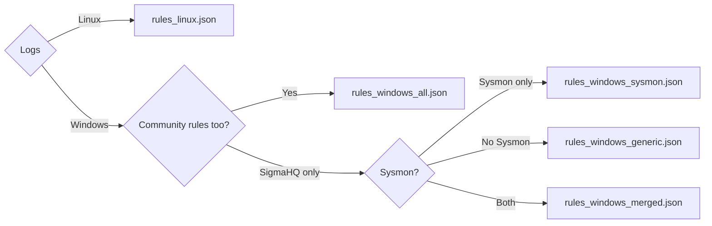

# Zircolite rules

[](https://github.com/wagga40/Zircolite-Rules-v2/actions/workflows/Update.yml)

Ready-to-use [Zircolite](https://github.com/wagga40/Zircolite) rulesets, converted daily from SigmaHQ and community Sigma repositories and validated before release.

<!-- ruleset-stats:start -->

<picture>
  <source media="(prefers-color-scheme: dark)" srcset="docs/assets/overview-dark.svg">
  
</picture>

<picture>
  <source media="(prefers-color-scheme: dark)" srcset="docs/assets/sources-dark.svg">
  
</picture>

Every ruleset, source, severity, ATT&CK tactic, and log source: [dashboard](docs/dashboard.md).

<!-- ruleset-stats:end -->

## Quick start

Zircolite 4.1 or newer installs every ruleset into `rules/` and checks each file against [the release manifest](release-manifest.json) first:

```bash
python3 zircolite.py -U
python3 zircolite.py --events logs/ --ruleset rules/rules_windows_all.json --min-level medium
python3 zircolite.py --events /var/log/audit/audit.log --ruleset rules/rules_linux.json
```

Or download one file: `curl -O https://raw.githubusercontent.com/wagga40/Zircolite-Rules-v2/main/rules_windows_all.json`.

## How it works

<picture>
  <source media="(prefers-color-scheme: dark)" srcset="docs/assets/pipeline-dark.svg">
  
</picture>

A rule is published only if its SQL runs in SQLite. A rule that fails stays out when a reviewed [exclusion](docs/maintenance.md#exclusions) covers its failure; otherwise its whole source keeps its last good rules and is marked stale.

## Which ruleset?



One community source has its own files, `rules_<source>_windows_{sysmon,generic,merged,native}.json` and `rules_<source>_linux.json`; correlations are in `experimental/`. Every file holds all severity levels, which `--min-level` filters. [Rulesets](docs/rulesets.md) explains the profiles and how to drop a source with `jq`.

## Updates and integrity

Rulesets are rebuilt daily at 01:23 UTC; a file changes only when its rules do. A *stale* source failed its latest update and still serves its last validated rules. To pin a version, replace `main` in a download URL with a commit SHA. To check a download, compare its SHA-256 with the manifest's:

```bash
sha256sum rules_windows_all.json
jq -r '.aggregates.windows_all.artifacts["rules_windows_all.json"]' release-manifest.json
jq -r '.sources.sigmahq.artifacts["rules_linux.json"]' release-manifest.json   # other files, by source
```

## Documentation

- [Dashboard](docs/dashboard.md): sources, freshness, counts, severities, ATT&CK tactics, and log sources, regenerated on every update.
- [Rulesets](docs/rulesets.md): profiles, the combined file, rule fields, filtering, and correlations.
- [Sources](docs/sources.md): repositories, licenses, and what is adapted or left out.
- [Maintenance](docs/maintenance.md): regenerating, validation, dependency upgrades, and CI.

## License

The generator is MIT. Rules keep their upstream licenses and authorship (DRL 1.1, GPL 3.0, CC0 1.0, Apache 2.0, MIT); see [licenses/](licenses/README.md).
