# Ruleset dashboard

Generated from the verified release on every update; do not edit.

<picture>
  <source media="(prefers-color-scheme: dark)" srcset="assets/overview-dark.svg">
  
</picture>

## Sources

| Source | Status | License | Revision | Last success (UTC) | Detection rules |
|---|---|---|---|---|---:|
| [sigmahq](https://github.com/SigmaHQ/sigma) | current | DRL-1.1 | [ddf1d4f87fd2](https://github.com/SigmaHQ/sigma/tree/ddf1d4f87fd283513ac1dbf7e178c8a4064047df) | 2026-11-28 05:58 | 3,061 |
| [adpack](https://github.com/404SecNotFound/Active-Directory-Pentest-Detection-Pack) | current | MIT | [00bfe53ad2da](https://github.com/404SecNotFound/Active-Directory-Pentest-Detection-Pack/tree/00bfe53ad2da9074cf2207d8473fc2e893d64e56) | 2026-11-28 05:59 | 208 |
| [dragon](https://github.com/frknaykc/Dragon-ThreatResearchHQ) | current | MIT | [47b5f65e6e65](https://github.com/frknaykc/Dragon-ThreatResearchHQ/tree/47b5f65e6e65dc9ce1a4829242cf61ff6e12eb98) | 2026-11-28 05:59 | 37 |
| [hatchepsoute](https://github.com/Hatchepsoute/sigma-rules) | current | Apache-2.0 | [3dd7e7075865](https://github.com/Hatchepsoute/sigma-rules/tree/3dd7e7075865be60d307aeb13deb33352e5429a5) | 2026-11-28 05:59 | 165 |
| [hayabusa](https://github.com/Yamato-Security/hayabusa-rules) | current | DRL-1.1 | [fefb31c530e5](https://github.com/Yamato-Security/hayabusa-rules/tree/fefb31c530e554116041ae106a5d40304fd9d251) | 2026-11-28 05:59 | 188 |
| [huntress](https://github.com/huntresslabs/threat-intel) | current | MIT | [bf913c1e770b](https://github.com/huntresslabs/threat-intel/tree/bf913c1e770b39274c66d5720299410daec13ecb) | 2026-11-28 05:59 | 46 |
| [joesecurity](https://github.com/joesecurity/sigma-rules) | current | GPL-3.0 | [cb91be06c8c9](https://github.com/joesecurity/sigma-rules/tree/cb91be06c8c95ce63aa9aa5006a7835678136a96) | 2026-11-28 05:59 | 110 |
| [loldrivers](https://github.com/magicsword-io/LOLDrivers) | current | Apache-2.0 | [39c70ca64ae9](https://github.com/magicsword-io/LOLDrivers/tree/39c70ca64ae9b66650e2c50e011eec6f7354e9cf) | 2026-11-28 05:59 | 6 |
| [lolrmm](https://github.com/magicsword-io/LOLRMM) | current | Apache-2.0 | [0c2d56639673](https://github.com/magicsword-io/LOLRMM/tree/0c2d56639673a232ff9d2548e16c6d045d3a1217) | 2026-11-28 05:59 | 702 |
| [mbabinski](https://github.com/mbabinski/Sigma-Rules) | current | GPL-3.0 | [9dea7a5c15cf](https://github.com/mbabinski/Sigma-Rules/tree/9dea7a5c15cfd422ec320e7fabd93f0c3634181d) | 2026-11-28 05:59 | 208 |
| [mdecrevoisier](https://github.com/mdecrevoisier/SIGMA-detection-rules) | current | CC0-1.0 | [d61408af8769](https://github.com/mdecrevoisier/SIGMA-detection-rules/tree/d61408af8769c74c96296b7ccc92d4bc3abb15af) | 2026-11-28 05:59 | 330 |
| [reversinglabs](https://github.com/reversinglabs/reversinglabs-siem-rules) | current | MIT | [23fc452b527f](https://github.com/reversinglabs/reversinglabs-siem-rules/tree/23fc452b527f2f8e08c26c6dffc0f734e750a2be) | 2026-11-28 05:59 | 7 |
| [tsale](https://github.com/tsale/Sigma_rules) | current | GPL-3.0 | [f5190e6b6c5b](https://github.com/tsale/Sigma_rules/tree/f5190e6b6c5ba9e6729845f13ac916590e90b0d8) | 2026-11-28 05:59 | 47 |
| [tyrian](https://github.com/zshguy/tyrian-detection-pack) | current | MIT | [b2cea417bcbd](https://github.com/zshguy/tyrian-detection-pack/tree/b2cea417bcbd1316ac571b29a5dc459ce387a7c2) | 2026-11-28 05:59 | 73 |
| [wrg11](https://github.com/WRG-11/wrg-sigma-rules) | current | MIT | [41c54e3fd904](https://github.com/WRG-11/wrg-sigma-rules/tree/41c54e3fd9042b29ebe458f6c7388b14b8a62df1) | 2026-11-28 05:59 | 110 |

## Inside `rules_windows_all.json`

Unique detections per severity, counting each rule once:

| Info | Low | Medium | High | Critical |
|---:|---:|---:|---:|---:|
| 137 | 363 | 2,124 | 2,004 | 320 |

A rule with several tactics counts once per tactic.

<picture>
  <source media="(prefers-color-scheme: dark)" srcset="assets/tactics-dark.svg">
  
</picture>

ATT&CK tactic table

| ATT&CK tactic | Rules |
|---|---:|
| Reconnaissance | 14 |
| Resource Development | 29 |
| Initial Access | 150 |
| Execution | 1,171 |
| Persistence | 875 |
| Privilege Escalation | 725 |
| Defense Evasion | 290 |
| Defense Impairment | 343 |
| Stealth | 933 |
| Credential Access | 472 |
| Discovery | 224 |
| Lateral Movement | 241 |
| Collection | 93 |
| Command and Control | 946 |
| Exfiltration | 69 |
| Impact | 116 |
| (no tactic tag) | 364 |

<picture>
  <source media="(prefers-color-scheme: dark)" srcset="assets/logsources-dark.svg">
  
</picture>

Log source table

| Log source (top 15) | Rules |
|---|---:|
| process_creation | 2,305 |
| service: security | 467 |
| file_event | 383 |
| network_connection | 311 |
| registry_set | 248 |
| ps_script | 224 |
| image_load | 140 |
| registry_event | 115 |
| service: sysmon | 115 |
| service: system | 115 |
| ps_module | 70 |
| process_access | 42 |
| service: application | 37 |
| dns_query | 36 |
| ps_classic_script | 35 |

## Detection rulesets

| Ruleset | Entries | Unique IDs | Info | Low | Medium | High | Critical |
|---|---:|---:|---:|---:|---:|---:|---:|
| [rules_windows_all.json](../rules_windows_all.json) | 7,676 | 4,943 | 144 | 545 | 3,305 | 3,166 | 516 |
| [rules_linux.json](../rules_linux.json) | 217 | 217 | 5 | 56 | 72 | 79 | 5 |
| [rules_windows_generic.json](../rules_windows_generic.json) | 2,280 | 2,280 | 11 | 164 | 906 | 1,099 | 100 |
| [rules_windows_merged.json](../rules_windows_merged.json) | 4,529 | 2,844 | 17 | 296 | 1,792 | 2,219 | 205 |
| [rules_windows_sysmon.json](../rules_windows_sysmon.json) | 2,844 | 2,844 | 13 | 206 | 1,127 | 1,371 | 127 |
| [rules_adpack_windows_generic.json](../rules_adpack_windows_generic.json) | 175 | 175 | 19 | 4 | 48 | 83 | 21 |
| [rules_adpack_windows_merged.json](../rules_adpack_windows_merged.json) | 260 | 208 | 21 | 8 | 67 | 133 | 31 |
| [rules_adpack_windows_sysmon.json](../rules_adpack_windows_sysmon.json) | 208 | 208 | 20 | 7 | 52 | 101 | 28 |
| [rules_dragon_linux.json](../rules_dragon_linux.json) | 5 | 5 | 0 | 0 | 0 | 1 | 4 |
| [rules_dragon_windows_generic.json](../rules_dragon_windows_generic.json) | 29 | 29 | 0 | 0 | 1 | 21 | 7 |
| [rules_dragon_windows_merged.json](../rules_dragon_windows_merged.json) | 61 | 32 | 0 | 0 | 2 | 44 | 15 |
| [rules_dragon_windows_sysmon.json](../rules_dragon_windows_sysmon.json) | 32 | 32 | 0 | 0 | 1 | 23 | 8 |
| [rules_hatchepsoute_linux.json](../rules_hatchepsoute_linux.json) | 57 | 57 | 0 | 1 | 11 | 31 | 14 |
| [rules_hatchepsoute_windows_generic.json](../rules_hatchepsoute_windows_generic.json) | 81 | 81 | 0 | 0 | 25 | 41 | 15 |
| [rules_hatchepsoute_windows_merged.json](../rules_hatchepsoute_windows_merged.json) | 177 | 108 | 0 | 0 | 54 | 86 | 37 |
| [rules_hatchepsoute_windows_sysmon.json](../rules_hatchepsoute_windows_sysmon.json) | 108 | 108 | 0 | 0 | 32 | 53 | 23 |
| [rules_hayabusa_windows_native.json](../rules_hayabusa_windows_native.json) | 188 | 188 | 100 | 26 | 40 | 21 | 1 |
| [rules_huntress_windows_generic.json](../rules_huntress_windows_generic.json) | 42 | 42 | 3 | 2 | 13 | 23 | 1 |
| [rules_huntress_windows_merged.json](../rules_huntress_windows_merged.json) | 83 | 46 | 5 | 4 | 29 | 43 | 2 |
| [rules_huntress_windows_sysmon.json](../rules_huntress_windows_sysmon.json) | 46 | 46 | 3 | 2 | 17 | 23 | 1 |
| [rules_joesecurity_windows_generic.json](../rules_joesecurity_windows_generic.json) | 110 | 110 | 0 | 1 | 0 | 1 | 108 |
| [rules_joesecurity_windows_merged.json](../rules_joesecurity_windows_merged.json) | 201 | 110 | 0 | 2 | 0 | 2 | 197 |
| [rules_joesecurity_windows_sysmon.json](../rules_joesecurity_windows_sysmon.json) | 110 | 110 | 0 | 1 | 0 | 1 | 108 |
| [rules_loldrivers_windows_sysmon.json](../rules_loldrivers_windows_sysmon.json) | 6 | 6 | 0 | 2 | 0 | 4 | 0 |
| [rules_lolrmm_windows_generic.json](../rules_lolrmm_windows_generic.json) | 376 | 376 | 0 | 0 | 374 | 2 | 0 |
| [rules_lolrmm_windows_merged.json](../rules_lolrmm_windows_merged.json) | 1,078 | 702 | 0 | 0 | 1,074 | 4 | 0 |
| [rules_lolrmm_windows_sysmon.json](../rules_lolrmm_windows_sysmon.json) | 702 | 702 | 0 | 0 | 700 | 2 | 0 |
| [rules_mbabinski_windows_generic.json](../rules_mbabinski_windows_generic.json) | 158 | 157 | 0 | 88 | 19 | 51 | 0 |
| [rules_mbabinski_windows_merged.json](../rules_mbabinski_windows_merged.json) | 357 | 208 | 0 | 199 | 43 | 115 | 0 |
| [rules_mbabinski_windows_sysmon.json](../rules_mbabinski_windows_sysmon.json) | 209 | 208 | 0 | 115 | 26 | 68 | 0 |
| [rules_mdecrevoisier_windows_generic.json](../rules_mdecrevoisier_windows_generic.json) | 321 | 321 | 0 | 2 | 73 | 243 | 3 |
| [rules_mdecrevoisier_windows_merged.json](../rules_mdecrevoisier_windows_merged.json) | 427 | 330 | 0 | 4 | 90 | 328 | 5 |
| [rules_mdecrevoisier_windows_sysmon.json](../rules_mdecrevoisier_windows_sysmon.json) | 330 | 330 | 0 | 2 | 73 | 252 | 3 |
| [rules_reversinglabs_windows_generic.json](../rules_reversinglabs_windows_generic.json) | 3 | 3 | 0 | 2 | 1 | 0 | 0 |
| [rules_reversinglabs_windows_merged.json](../rules_reversinglabs_windows_merged.json) | 9 | 7 | 0 | 4 | 2 | 3 | 0 |
| [rules_reversinglabs_windows_sysmon.json](../rules_reversinglabs_windows_sysmon.json) | 7 | 7 | 0 | 2 | 2 | 3 | 0 |
| [rules_tsale_windows_generic.json](../rules_tsale_windows_generic.json) | 46 | 46 | 0 | 0 | 8 | 38 | 0 |
| [rules_tsale_windows_merged.json](../rules_tsale_windows_merged.json) | 89 | 47 | 0 | 0 | 16 | 73 | 0 |
| [rules_tsale_windows_sysmon.json](../rules_tsale_windows_sysmon.json) | 47 | 47 | 0 | 0 | 9 | 38 | 0 |
| [rules_tyrian_linux.json](../rules_tyrian_linux.json) | 15 | 15 | 0 | 0 | 3 | 8 | 4 |
| [rules_tyrian_windows_generic.json](../rules_tyrian_windows_generic.json) | 57 | 57 | 0 | 0 | 9 | 29 | 19 |
| [rules_tyrian_windows_merged.json](../rules_tyrian_windows_merged.json) | 61 | 58 | 0 | 0 | 9 | 33 | 19 |
| [rules_tyrian_windows_sysmon.json](../rules_tyrian_windows_sysmon.json) | 58 | 58 | 0 | 0 | 9 | 30 | 19 |
| [rules_wrg11_linux.json](../rules_wrg11_linux.json) | 18 | 18 | 0 | 0 | 3 | 11 | 4 |
| [rules_wrg11_windows_generic.json](../rules_wrg11_windows_generic.json) | 67 | 67 | 1 | 0 | 39 | 25 | 2 |
| [rules_wrg11_windows_merged.json](../rules_wrg11_windows_merged.json) | 150 | 92 | 1 | 0 | 87 | 58 | 4 |
| [rules_wrg11_windows_sysmon.json](../rules_wrg11_windows_sysmon.json) | 91 | 91 | 0 | 0 | 54 | 35 | 2 |

## Experimental correlation rulesets

Zircolite 4.1 or newer runs these; see [experimental/](../experimental/README.md).

| Ruleset | Entries | Unique IDs | Info | Low | Medium | High | Critical |
|---|---:|---:|---:|---:|---:|---:|---:|
| [rules_adpack_windows_generic_correlation.json](../experimental/rules_adpack_windows_generic_correlation.json) | 19 | 19 | 1 | 2 | 8 | 5 | 3 |
| [rules_adpack_windows_merged_correlation.json](../experimental/rules_adpack_windows_merged_correlation.json) | 20 | 19 | 1 | 2 | 8 | 5 | 4 |
| [rules_adpack_windows_sysmon_correlation.json](../experimental/rules_adpack_windows_sysmon_correlation.json) | 19 | 19 | 1 | 2 | 8 | 5 | 3 |
| [rules_hatchepsoute_windows_merged_correlation.json](../experimental/rules_hatchepsoute_windows_merged_correlation.json) | 1 | 1 | 0 | 0 | 0 | 1 | 0 |
| [rules_hatchepsoute_windows_sysmon_correlation.json](../experimental/rules_hatchepsoute_windows_sysmon_correlation.json) | 1 | 1 | 0 | 0 | 0 | 1 | 0 |
| [rules_hayabusa_windows_native_correlation.json](../experimental/rules_hayabusa_windows_native_correlation.json) | 3 | 3 | 0 | 0 | 3 | 0 | 0 |
| [rules_mbabinski_windows_generic_correlation.json](../experimental/rules_mbabinski_windows_generic_correlation.json) | 2 | 2 | 0 | 0 | 2 | 0 | 0 |
| [rules_mbabinski_windows_merged_correlation.json](../experimental/rules_mbabinski_windows_merged_correlation.json) | 3 | 2 | 0 | 0 | 3 | 0 | 0 |
| [rules_mbabinski_windows_sysmon_correlation.json](../experimental/rules_mbabinski_windows_sysmon_correlation.json) | 2 | 2 | 0 | 0 | 2 | 0 | 0 |
| [rules_mdecrevoisier_windows_generic_correlation.json](../experimental/rules_mdecrevoisier_windows_generic_correlation.json) | 7 | 7 | 0 | 0 | 0 | 7 | 0 |
| [rules_mdecrevoisier_windows_merged_correlation.json](../experimental/rules_mdecrevoisier_windows_merged_correlation.json) | 7 | 7 | 0 | 0 | 0 | 7 | 0 |
| [rules_mdecrevoisier_windows_sysmon_correlation.json](../experimental/rules_mdecrevoisier_windows_sysmon_correlation.json) | 7 | 7 | 0 | 0 | 0 | 7 | 0 |
| [rules_wrg11_windows_generic_correlation.json](../experimental/rules_wrg11_windows_generic_correlation.json) | 12 | 12 | 2 | 0 | 3 | 6 | 1 |
| [rules_wrg11_windows_merged_correlation.json](../experimental/rules_wrg11_windows_merged_correlation.json) | 24 | 18 | 2 | 0 | 7 | 13 | 2 |
| [rules_wrg11_windows_sysmon_correlation.json](../experimental/rules_wrg11_windows_sysmon_correlation.json) | 18 | 18 | 2 | 0 | 5 | 9 | 2 |

Entries are exported rule objects; SQL variants of one rule share its ID. Profiles overlap, so do not add counts across files. Severity columns count entries at each exact level.
