# Ruleset dashboard

Generated from the verified release on every update; do not edit.

<picture>
  <source media="(prefers-color-scheme: dark)" srcset="assets/overview-dark.svg">
  
</picture>

## Sources

| Source | Status | License | Revision | Last success (UTC) | Detection rules |
|---|---|---|---|---|---:|
| [sigmahq](https://github.com/SigmaHQ/sigma) | current | DRL-1.1 | [8a4813404ea3](https://github.com/SigmaHQ/sigma/tree/8a4813404ea3074890e0cda9272d4d1a8b2941d6) | 2026-10-11 09:15 | 3,049 |
| [dragon](https://github.com/frknaykc/Dragon-ThreatResearchHQ) | current | MIT | [47b5f65e6e65](https://github.com/frknaykc/Dragon-ThreatResearchHQ/tree/47b5f65e6e65dc9ce1a4829242cf61ff6e12eb98) | 2026-10-11 09:15 | 37 |
| [hatchepsoute](https://github.com/Hatchepsoute/sigma-rules) | current | Apache-2.0 | [c04c81bb42b9](https://github.com/Hatchepsoute/sigma-rules/tree/c04c81bb42b926677d596991a4a50a8afd2c91db) | 2026-10-11 09:15 | 142 |
| [hayabusa](https://github.com/Yamato-Security/hayabusa-rules) | current | DRL-1.1 | [04af3d207cae](https://github.com/Yamato-Security/hayabusa-rules/tree/04af3d207cae784183e0e5e82c1132ee866bbd67) | 2026-10-11 09:16 | 188 |
| [joesecurity](https://github.com/joesecurity/sigma-rules) | current | GPL-3.0 | [cb91be06c8c9](https://github.com/joesecurity/sigma-rules/tree/cb91be06c8c95ce63aa9aa5006a7835678136a96) | 2026-10-11 09:16 | 110 |
| [loldrivers](https://github.com/magicsword-io/LOLDrivers) | current | Apache-2.0 | [9e8d6b30000d](https://github.com/magicsword-io/LOLDrivers/tree/9e8d6b30000dc88951597de5bcb9556daa2a07c1) | 2026-10-11 09:16 | 6 |
| [lolrmm](https://github.com/magicsword-io/LOLRMM) | current | Apache-2.0 | [befa4a7f822a](https://github.com/magicsword-io/LOLRMM/tree/befa4a7f822a858f81aee9ea754af6ec4c34b76f) | 2026-10-11 09:16 | 727 |
| [mbabinski](https://github.com/mbabinski/Sigma-Rules) | current | GPL-3.0 | [9dea7a5c15cf](https://github.com/mbabinski/Sigma-Rules/tree/9dea7a5c15cfd422ec320e7fabd93f0c3634181d) | 2026-10-11 09:16 | 208 |
| [mdecrevoisier](https://github.com/mdecrevoisier/SIGMA-detection-rules) | current | CC0-1.0 | [d61408af8769](https://github.com/mdecrevoisier/SIGMA-detection-rules/tree/d61408af8769c74c96296b7ccc92d4bc3abb15af) | 2026-10-11 09:16 | 330 |
| [reversinglabs](https://github.com/reversinglabs/reversinglabs-siem-rules) | current | MIT | [23fc452b527f](https://github.com/reversinglabs/reversinglabs-siem-rules/tree/23fc452b527f2f8e08c26c6dffc0f734e750a2be) | 2026-10-11 09:16 | 7 |
| [tsale](https://github.com/tsale/Sigma_rules) | current | GPL-3.0 | [f5190e6b6c5b](https://github.com/tsale/Sigma_rules/tree/f5190e6b6c5ba9e6729845f13ac916590e90b0d8) | 2026-10-11 09:16 | 47 |
| [tyrian](https://github.com/zshguy/tyrian-detection-pack) | current | MIT | [b2cea417bcbd](https://github.com/zshguy/tyrian-detection-pack/tree/b2cea417bcbd1316ac571b29a5dc459ce387a7c2) | 2026-10-11 09:16 | 73 |
| [wrg11](https://github.com/WRG-11/wrg-sigma-rules) | current | MIT | [5d739770d559](https://github.com/WRG-11/wrg-sigma-rules/tree/5d739770d559c9882bb293bab353f777b8923377) | 2026-10-11 09:16 | 110 |

## Inside `rules_windows_all.json`

Counts are distinct rules; a rule with several tactics counts once per tactic.

| Info | Low | Medium | High | Critical |
|---:|---:|---:|---:|---:|
| 114 | 351 | 2,078 | 1,867 | 290 |

<picture>
  <source media="(prefers-color-scheme: dark)" srcset="assets/tactics-dark.svg">
  
</picture>

ATT&CK tactic table

| ATT&CK tactic | Rules |
|---|---:|
| Reconnaissance | 14 |
| Resource Development | 28 |
| Initial Access | 144 |
| Execution | 1,138 |
| Persistence | 809 |
| Privilege Escalation | 661 |
| Defense Evasion | 230 |
| Defense Impairment | 337 |
| Stealth | 934 |
| Credential Access | 352 |
| Discovery | 206 |
| Lateral Movement | 206 |
| Collection | 83 |
| Command and Control | 954 |
| Exfiltration | 68 |
| Impact | 111 |
| (no tactic tag) | 352 |

<picture>
  <source media="(prefers-color-scheme: dark)" srcset="assets/logsources-dark.svg">
  
</picture>

Log source table

| Log source (top 15) | Rules |
|---|---:|
| process_creation | 2,223 |
| file_event | 374 |
| service: security | 362 |
| network_connection | 331 |
| registry_set | 236 |
| ps_script | 220 |
| image_load | 132 |
| service: sysmon | 114 |
| registry_event | 112 |
| service: system | 106 |
| ps_module | 70 |
| process_access | 39 |
| ps_classic_script | 35 |
| dns_query | 32 |
| service: application | 32 |

## Detection rulesets

| Ruleset | Entries | Unique IDs | Info | Low | Medium | High | Critical |
|---|---:|---:|---:|---:|---:|---:|---:|
| [rules_windows_all.json](../rules_windows_all.json) | 7,344 | 4,696 | 118 | 532 | 3,226 | 2,987 | 481 |
| [rules_linux.json](../rules_linux.json) | 216 | 216 | 5 | 56 | 71 | 79 | 5 |
| [rules_windows_generic.json](../rules_windows_generic.json) | 2,282 | 2,282 | 11 | 163 | 907 | 1,101 | 100 |
| [rules_windows_merged.json](../rules_windows_merged.json) | 4,523 | 2,833 | 17 | 295 | 1,788 | 2,218 | 205 |
| [rules_windows_sysmon.json](../rules_windows_sysmon.json) | 2,833 | 2,833 | 13 | 205 | 1,121 | 1,367 | 127 |
| [rules_dragon_linux.json](../rules_dragon_linux.json) | 5 | 5 | 0 | 0 | 0 | 1 | 4 |
| [rules_dragon_windows_generic.json](../rules_dragon_windows_generic.json) | 29 | 29 | 0 | 0 | 1 | 21 | 7 |
| [rules_dragon_windows_merged.json](../rules_dragon_windows_merged.json) | 61 | 32 | 0 | 0 | 2 | 44 | 15 |
| [rules_dragon_windows_sysmon.json](../rules_dragon_windows_sysmon.json) | 32 | 32 | 0 | 0 | 1 | 23 | 8 |
| [rules_hatchepsoute_linux.json](../rules_hatchepsoute_linux.json) | 45 | 45 | 0 | 1 | 9 | 22 | 13 |
| [rules_hatchepsoute_windows_generic.json](../rules_hatchepsoute_windows_generic.json) | 73 | 73 | 0 | 0 | 25 | 34 | 14 |
| [rules_hatchepsoute_windows_merged.json](../rules_hatchepsoute_windows_merged.json) | 162 | 97 | 0 | 0 | 53 | 74 | 35 |
| [rules_hatchepsoute_windows_sysmon.json](../rules_hatchepsoute_windows_sysmon.json) | 97 | 97 | 0 | 0 | 31 | 44 | 22 |
| [rules_hayabusa_windows_native.json](../rules_hayabusa_windows_native.json) | 188 | 188 | 100 | 26 | 40 | 21 | 1 |
| [rules_joesecurity_windows_generic.json](../rules_joesecurity_windows_generic.json) | 110 | 110 | 0 | 1 | 0 | 1 | 108 |
| [rules_joesecurity_windows_merged.json](../rules_joesecurity_windows_merged.json) | 201 | 110 | 0 | 2 | 0 | 2 | 197 |
| [rules_joesecurity_windows_sysmon.json](../rules_joesecurity_windows_sysmon.json) | 110 | 110 | 0 | 1 | 0 | 1 | 108 |
| [rules_loldrivers_windows_sysmon.json](../rules_loldrivers_windows_sysmon.json) | 6 | 6 | 0 | 1 | 1 | 4 | 0 |
| [rules_lolrmm_windows_generic.json](../rules_lolrmm_windows_generic.json) | 371 | 371 | 0 | 0 | 369 | 2 | 0 |
| [rules_lolrmm_windows_merged.json](../rules_lolrmm_windows_merged.json) | 1,098 | 727 | 0 | 0 | 1,094 | 4 | 0 |
| [rules_lolrmm_windows_sysmon.json](../rules_lolrmm_windows_sysmon.json) | 727 | 727 | 0 | 0 | 725 | 2 | 0 |
| [rules_mbabinski_windows_generic.json](../rules_mbabinski_windows_generic.json) | 165 | 164 | 0 | 89 | 20 | 56 | 0 |
| [rules_mbabinski_windows_merged.json](../rules_mbabinski_windows_merged.json) | 364 | 208 | 0 | 200 | 44 | 120 | 0 |
| [rules_mbabinski_windows_sysmon.json](../rules_mbabinski_windows_sysmon.json) | 209 | 208 | 0 | 115 | 26 | 68 | 0 |
| [rules_mdecrevoisier_windows_generic.json](../rules_mdecrevoisier_windows_generic.json) | 323 | 323 | 0 | 2 | 73 | 245 | 3 |
| [rules_mdecrevoisier_windows_merged.json](../rules_mdecrevoisier_windows_merged.json) | 429 | 330 | 0 | 4 | 90 | 330 | 5 |
| [rules_mdecrevoisier_windows_sysmon.json](../rules_mdecrevoisier_windows_sysmon.json) | 330 | 330 | 0 | 2 | 73 | 252 | 3 |
| [rules_reversinglabs_windows_generic.json](../rules_reversinglabs_windows_generic.json) | 6 | 6 | 0 | 2 | 1 | 3 | 0 |
| [rules_reversinglabs_windows_merged.json](../rules_reversinglabs_windows_merged.json) | 12 | 7 | 0 | 4 | 2 | 6 | 0 |
| [rules_reversinglabs_windows_sysmon.json](../rules_reversinglabs_windows_sysmon.json) | 7 | 7 | 0 | 2 | 2 | 3 | 0 |
| [rules_tsale_windows_generic.json](../rules_tsale_windows_generic.json) | 46 | 46 | 0 | 0 | 8 | 38 | 0 |
| [rules_tsale_windows_merged.json](../rules_tsale_windows_merged.json) | 89 | 47 | 0 | 0 | 16 | 73 | 0 |
| [rules_tsale_windows_sysmon.json](../rules_tsale_windows_sysmon.json) | 47 | 47 | 0 | 0 | 9 | 38 | 0 |
| [rules_tyrian_linux.json](../rules_tyrian_linux.json) | 15 | 15 | 0 | 0 | 3 | 8 | 4 |
| [rules_tyrian_windows_generic.json](../rules_tyrian_windows_generic.json) | 57 | 57 | 0 | 0 | 9 | 29 | 19 |
| [rules_tyrian_windows_merged.json](../rules_tyrian_windows_merged.json) | 61 | 58 | 0 | 0 | 9 | 33 | 19 |
| [rules_tyrian_windows_sysmon.json](../rules_tyrian_windows_sysmon.json) | 58 | 58 | 0 | 0 | 9 | 30 | 19 |
| [rules_wrg11_linux.json](../rules_wrg11_linux.json) | 18 | 18 | 0 | 0 | 3 | 11 | 4 |
| [rules_wrg11_windows_generic.json](../rules_wrg11_windows_generic.json) | 67 | 67 | 1 | 0 | 39 | 25 | 2 |
| [rules_wrg11_windows_merged.json](../rules_wrg11_windows_merged.json) | 150 | 92 | 1 | 0 | 87 | 58 | 4 |
| [rules_wrg11_windows_sysmon.json](../rules_wrg11_windows_sysmon.json) | 91 | 91 | 0 | 0 | 54 | 35 | 2 |

## Experimental correlation rulesets

Zircolite 4.1 or newer runs these; see [experimental/](../experimental/README.md).

| Ruleset | Entries | Unique IDs | Info | Low | Medium | High | Critical |
|---|---:|---:|---:|---:|---:|---:|---:|
| [rules_hatchepsoute_windows_merged_correlation.json](../experimental/rules_hatchepsoute_windows_merged_correlation.json) | 1 | 1 | 0 | 0 | 0 | 1 | 0 |
| [rules_hatchepsoute_windows_sysmon_correlation.json](../experimental/rules_hatchepsoute_windows_sysmon_correlation.json) | 1 | 1 | 0 | 0 | 0 | 1 | 0 |
| [rules_hayabusa_windows_native_correlation.json](../experimental/rules_hayabusa_windows_native_correlation.json) | 3 | 3 | 0 | 0 | 3 | 0 | 0 |
| [rules_mbabinski_windows_generic_correlation.json](../experimental/rules_mbabinski_windows_generic_correlation.json) | 2 | 2 | 0 | 0 | 2 | 0 | 0 |
| [rules_mbabinski_windows_merged_correlation.json](../experimental/rules_mbabinski_windows_merged_correlation.json) | 3 | 2 | 0 | 0 | 3 | 0 | 0 |
| [rules_mbabinski_windows_sysmon_correlation.json](../experimental/rules_mbabinski_windows_sysmon_correlation.json) | 2 | 2 | 0 | 0 | 2 | 0 | 0 |
| [rules_mdecrevoisier_windows_generic_correlation.json](../experimental/rules_mdecrevoisier_windows_generic_correlation.json) | 7 | 7 | 0 | 0 | 0 | 7 | 0 |
| [rules_mdecrevoisier_windows_merged_correlation.json](../experimental/rules_mdecrevoisier_windows_merged_correlation.json) | 7 | 7 | 0 | 0 | 0 | 7 | 0 |
| [rules_mdecrevoisier_windows_sysmon_correlation.json](../experimental/rules_mdecrevoisier_windows_sysmon_correlation.json) | 7 | 7 | 0 | 0 | 0 | 7 | 0 |
| [rules_wrg11_windows_generic_correlation.json](../experimental/rules_wrg11_windows_generic_correlation.json) | 12 | 12 | 2 | 0 | 3 | 6 | 1 |
| [rules_wrg11_windows_merged_correlation.json](../experimental/rules_wrg11_windows_merged_correlation.json) | 24 | 18 | 2 | 0 | 7 | 13 | 2 |
| [rules_wrg11_windows_sysmon_correlation.json](../experimental/rules_wrg11_windows_sysmon_correlation.json) | 18 | 18 | 2 | 0 | 5 | 9 | 2 |

Entries are exported rule objects; SQL variants of one rule share its ID. Profiles overlap, so do not add counts across files. Severity columns are exact levels.
