# Rulesets

Current counts are on the [dashboard](dashboard.md).

## Names and profiles

Files are named `rules_[<source>_]<platform>[_<profile>].json`; SigmaHQ files have no source prefix. A profile describes how Sigma log sources are mapped, not which channels a file reads.

| Profile | Mapping |
|---|---|
| `sysmon` | Sigma categories mapped to Sysmon events, plus Windows service rules |
| `generic` | Sigma categories mapped to Windows audit events (process creation becomes Security 4688), plus Windows service rules |
| `merged` | `sysmon` and `generic` together; when a rule has both variants, titles end in ` - Sysmon` or ` - Generic` |
| `native` | Rules that already select Windows channels and event IDs (Hayabusa) |
| `linux` | Linux rules with Sigma field names |

A source has no file for a profile it has no rules for. Every file contains all severity levels. Severity is the upstream author's rating and is not comparable across sources.

## The combined Windows file

`rules_windows_all.json` merges each source's `merged` file, or its `sysmon`, `generic`, and `native` files, into one Windows ruleset.

<picture>
  <source media="(prefers-color-scheme: dark)" srcset="assets/families-dark.svg">
  
</picture>

- It drops exact duplicates (same ID and SQL), keeping SigmaHQ first and then sources in name order. Different SQL variants of one rule remain.
- It excludes Linux rules and correlations.
- It is rebuilt after every update from each source's published files; its inputs are recorded in `provenance/windows_all.json`.

## Rule fields

Entries use the SQLite backend's schema version 2:

- `rule` holds the SQL queries.
- `required_fields` lists the columns those queries use.
- `result_type` is `event` or `correlation`.
- The usual Sigma metadata comes along.

This repository adds three fields:

- `filename`: the rule's path in its source repository.
- `source`: the source name used on the dashboard.
- `license`: the source's SPDX license.

## Filtering

Zircolite 4.1 or newer loads only the rules at a level and above with `--min-level`. To drop a source or a license, filter a copy with `jq`:

```bash
# Without one source: LOLRMM also matches legitimate remote-management use
jq '[.[] | select(.source != "lolrmm")]' rules_windows_all.json > no_rmm.json

# Without GPL-licensed rules
jq '[.[] | select(.license != "GPL-3.0")]' rules_windows_all.json > no_gpl.json

# High and critical only, for tools without --min-level
jq '[.[] | select(.level == "high" or .level == "critical")]' rules_windows_all.json > high_plus.json
```

## Experimental correlations

`experimental/*_correlation.json` holds Sigma correlation rules: event counts, value counts, and temporal sequences.

- They are not default rulesets. Zircolite 4.1 or newer runs them and reports alerts with their evidence; older versions report the alert rows as ordinary events.
- They need SQLite 3.38 or newer with JSON functions.

See [experimental/README.md](../experimental/README.md).
